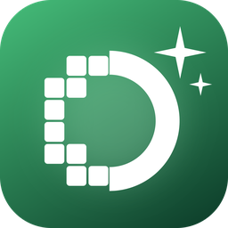
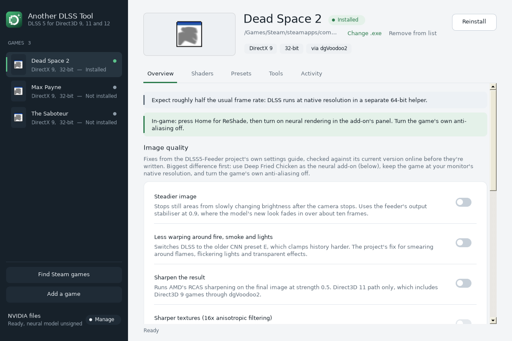
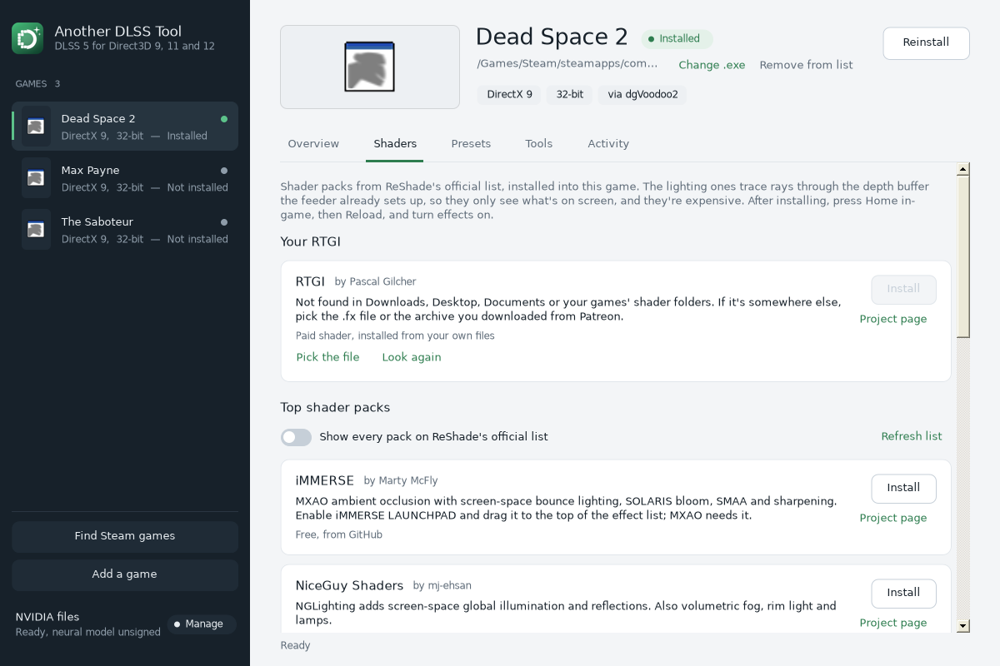
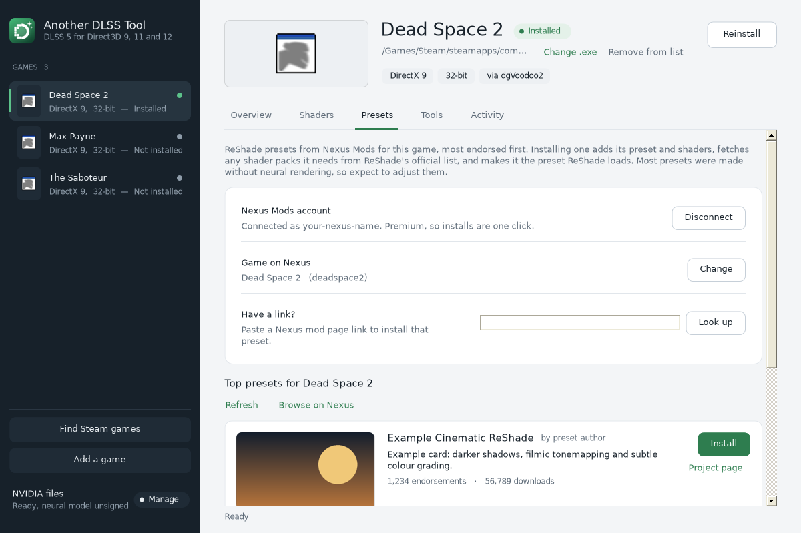
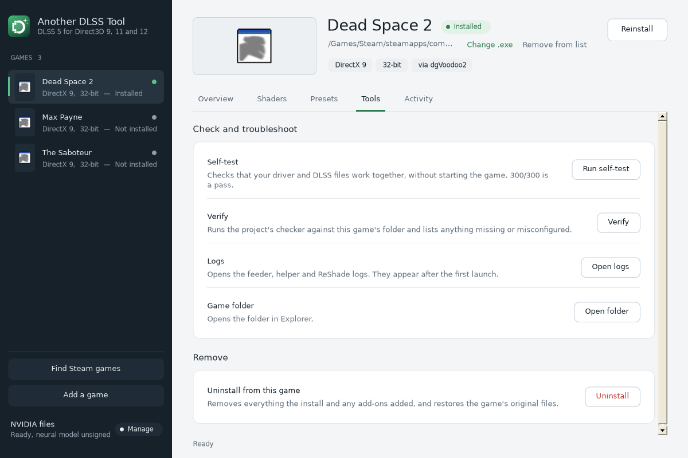

<p align="center">
  
</p>

<h1 align="center">Another DLSS Tool</h1>

<p align="center">A Windows app that sets up DLSS 5 neural rendering in Direct3D 9, 11 and 12 games that never shipped with DLSS, and manages shaders and ReShade presets for each game.</p>

---

## What it does

Older games like Dead Space 2 or The Saboteur don't give DLSS the data it needs. The open-source [DLSS5-Feeder](https://github.com/jlrouzies-fr/DLSS5-Feeder) project fills that gap: it pulls the game's depth buffer through ReShade, estimates motion vectors with a shader, and feeds both to DLSS so a neural-rendering add-on can run. Setting that up by hand means juggling dgVoodoo2, ReShade, a 32-bit/64-bit helper and several DLLs per game.

Another DLSS Tool puts all of that behind one window:

- **A game library.** Finds your Steam games automatically, or takes any game's `.exe`. Reads each game's graphics API and bitness from the executable itself, and shows its cover art.
- **One-click install.** Runs the official `Install-DLSS5Feeder.ps1`, downloaded fresh from the project's GitHub each time, with the right options for the game.
- **Full undo.** Snapshots the game folder before the first install, so Uninstall restores it exactly.
- **Image-quality fixes** from the feeder project's own settings guide, as switches.
- **Shaders.** Installs the top packs from ReShade's official list (iMMERSE, NiceGuy, qUINT, METEOR, SweetFX and more) and can find and install a paid RTGI copy already on your PC.
- **Presets from Nexus Mods.** Lists the most endorsed ReShade presets for each game, with images. With Nexus Premium, Install downloads one, adds the shader packs it needs, offers to switch off effects that clash with neural rendering, and makes it the active preset.
- **Safety checks.** Flags games with anti-cheat and games that already ship DLSS, and shows signature status and SHA-256 hashes for the NVIDIA files.

## Walkthrough

### 1. Add your games

Press **Find Steam games** to scan every Steam library, or **Add a game** to pick any `.exe`. Each game appears in the sidebar with its cover art, graphics API, bitness and install status.

### 2. Install the feeder

Pick a game and press **Install**. The app shows exactly what it will add, snapshots the folder, then runs the official installer in its own window. Answer its questions there.

The **Overview** tab holds the per-game options (graphics API, neural-rendering add-on, motion-vector shader) and the image-quality switches. Notes at the top call out anything specific to the game, such as the frame-rate cost of the 32-bit helper.



### 3. Add shaders

The **Shaders** tab installs the top packs from ReShade's official list into the game, one click each. Switch on *Show every pack* for the full list. If you own Pascal Gilcher's RTGI, the app searches Downloads, Desktop, Documents and your games' shader folders for it, or you can pick the file.



### 4. Install a preset from Nexus Mods

On the **Presets** tab, connect your Nexus account with your personal API key (Nexus Mods: Site preferences, API keys). The key is stored on your PC only, encrypted for your Windows account. The tab then lists the game's most endorsed ReShade presets.

With Nexus Premium, **Install** does everything: downloads the file, adds its shaders, fetches missing shader packs, offers to turn off anti-aliasing, sharpening and grain (they fight neural rendering), and makes it the active preset. Without Premium, the button opens the mod page; download it there and use **Install from a file**. You can also paste any Nexus mod link.



### 5. Check and troubleshoot

The **Tools** tab runs the DLSS self-test (300/300 means your driver and DLSS files work together), runs the project's verifier, opens the logs, and uninstalls everything the app added to a game.



In-game, press **Home** for the ReShade overlay, turn on neural rendering in the add-on's panel, and turn the game's own anti-aliasing off.

> The screenshots come from a test build with sample data. Example preset cards and the placeholder game icons stand in for real Nexus listings and Steam cover art.

## Requirements

- Windows 10 or 11 with .NET Framework 4.5 or newer (built into both).
- An NVIDIA RTX graphics card.
- The two NVIDIA files described in [stage/files/README.md](stage/files/README.md). On RTX 20, 30 and 40 cards the neural pass needs the community build of `nvngx_dlssnr.dll`.
- Nexus Mods Premium for one-click preset downloads (optional).

## Building from source

The app is plain C# WinForms targeting .NET Framework 4.5, with no NuGet packages.

```sh
./build.sh
```

`build.sh` compiles `out/AnotherDLSSTool.exe` with Mono's `mcs`. If both NVIDIA files are in `stage/files`, it also builds `out/Another-DLSS-Tool-Installer.exe` with NSIS. `logo/make_logo.py` regenerates the logo and icon.

| File | What's in it |
| --- | --- |
| `src/Core.cs` | Game library, PE reader for API and bitness detection, snapshots and undo |
| `src/MainForm*.cs` | The main window and its tabs |
| `src/Controls.cs` | Theme and custom-drawn controls |
| `src/Shaders.cs` | ReShade's official shader list, shader installs, RTGI search |
| `src/Presets.cs` | Preset install, dependency resolution, active-preset switching |
| `src/Nexus.cs` | Nexus Mods API client |
| `src/Quality.cs` | Image-quality settings from the feeder project's guide |
| `src/Art.cs` | Game cover art from Steam |

## Notes and caveats

- **Not affiliated with NVIDIA, Nexus Mods, ReShade or the DLSS5-Feeder project.** The heavy lifting is the DLSS5-Feeder project's work; this app wraps its official installer.
- **NVIDIA's DLLs are not included in this repository.** You supply them.
- **Don't use this in online games with anti-cheat.** Injecting DLLs can get accounts banned. The app warns when it detects anti-cheat.
- **The installer and app are not code-signed,** so Windows SmartScreen will warn on first run.
- Neural rendering runs at native resolution and costs performance. In 32-bit games, which go through a separate 64-bit helper, expect roughly half the usual frame rate.

## Third-party code and content

All of the code in this repository was written for this project; none is copied from other projects. Nothing from other projects is bundled either. When you press a button, the app downloads these from their authors' official sources, and each keeps its own licence:

| What | Author | Licence | How the app uses it |
| --- | --- | --- | --- |
| [DLSS5-Feeder](https://github.com/jlrouzies-fr/DLSS5-Feeder) installer, feeder and verifier | Jean-Laurent Rouzies | MIT | Downloaded from the project's GitHub and run for each install |
| [ReShade](https://reshade.me) and its [official shader and add-on lists](https://github.com/crosire/reshade-shaders) | crosire | BSD-3-Clause (ReShade); per pack for shaders | Installed by the feeder; shader packs downloaded from each author's repository |
| [iMMERSE](https://github.com/martymcmodding/iMMERSE), RTGI | Pascal Gilcher | Proprietary, free to use (iMMERSE); paid (RTGI) | iMMERSE downloaded from the author's repository; RTGI only from your own purchased copy |
| [NiceGuy Shaders](https://github.com/mj-ehsan/NiceGuy-Shaders) | mj-ehsan | CC0 | Downloaded from the author's repository |
| [dgVoodoo2](http://dege.freeweb.hu/dgVoodoo2/) | Dege | Freeware | Installed by the feeder for Direct3D 8 and 9 games |
| RenoDX, Deep Fried Chicken, OptiScaler | their respective authors | see each project | Neural-rendering add-ons, installed by the feeder or from your own download |
| NVIDIA DLSS runtime files | NVIDIA | NVIDIA's DLSS licence | Never included; you supply them |
| ReShade presets on [Nexus Mods](https://www.nexusmods.com) | each preset's author | see each mod page | Downloaded with your own Nexus account |
| Game cover art | the games' publishers, via Steam | n/a | Shown from Steam's cache or CDN on your PC; never stored in this repository |

Nexus Mods' public GraphQL schema, published in [NexusMods.App](https://github.com/Nexus-Mods/NexusMods.App) (GPL-3.0), was used as a reference for the shape of the search query. No code from that project is included.

Built with [Mono](https://www.mono-project.com) and [NSIS](https://nsis.sourceforge.io). The logo was drawn for this project with [Pillow](https://python-pillow.org) (`logo/make_logo.py`).

**If you publish builds:** don't attach an installer that contains NVIDIA's DLLs to a GitHub release. Build the release without them and let people add their own.

## Licence

[MIT](LICENSE), covering the code and logo in this repository. Everything listed above stays under its own licence.
